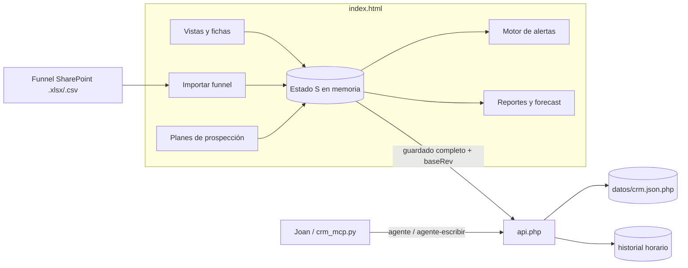

# Auditoría del CRM actual

**Repositorio:** Yekill-CMM/CRM, rama principal, commit `88d5cb4` (10-11-2026, "Agendar reuniones en Outlook desde el CRM")
**Fecha:** 12-11-2026
**Alcance:** Etapa 1 de la especificación "Evolución del CRM Comercial — First Security". No se modificó código, esquema ni datos.

---

## 1. Resumen

El CRM funciona y está bien resuelto para lo que nació: un solo usuario, sin dependencias, con guardado en el servidor, control de versiones y un agente (Joan) con permisos acotados. La base para Prospección (Etapa 2) y para el importador del funnel (Etapa 3) ya existe y se puede aprovechar casi entera.

Lo que no existe todavía: contratos, facturación real, metas por línea SSFF/SSEE y la separación entre contribución comercial, facturación proyectada y facturación real. Y hay tres cosas del importador actual que chocan directamente con la especificación y conviene corregir antes de construir encima:

1. **El importador borra.** Las oportunidades que no vienen en el Excel nuevo se eliminan del CRM con sus actividades, tareas y ofertas. La especificación pide lo contrario: el historial comercial local nunca se pierde.
2. **Se identifica por título cuando falta el ID.** La especificación prohíbe usar el título como clave definitiva.
3. **SSFF y SSEE se suman en un solo "monto mensual".** No hay forma de medir cumplimiento por línea.

Hay además una decisión de arquitectura pendiente (sección 7): los datos viven en un único archivo JSON. Alcanza para las etapas 2 y 3, pero no para facturación, conciliación ni una auditoría completa.

---

## 2. Levantamiento técnico

| # | Punto | Situación actual |
|---|---|---|
| 1 | Lenguaje y framework | Frontend: HTML + JavaScript puro en un solo archivo (`app/index.html`, ~244 KB, 1.853 líneas), sin librerías ni build. Backend: PHP 7.2+ sin framework (`app/api.php`, 651 líneas). Conector MCP para Joan en Python estándar (`local/crm_mcp.py`). |
| 2 | Arquitectura | Aplicación de página única. El navegador mantiene todo el estado en memoria (objeto `S`) y lo guarda completo en el servidor en cada cambio. El servidor no tiene lógica de negocio, salvo el resumen y las escrituras acotadas del agente. |
| 3 | Directorios | `app/` (programa), `app/datos/` (datos, no versionado), `local/` (instaladores para joansvr), `docs/`, `supabase/migrations/` (diseño SQL que **no está en uso**). |
| 4 | Motor de datos | No hay base de datos. Un archivo `datos/crm.json.php` con todo el CRM, protegido con cabecera `<?php exit; ?>`. Ajustes aparte en `datos/ajustes.json.php`. |
| 5 | Tablas y relaciones | Arreglos dentro del JSON: `companies` (con `sites` anidados), `contacts`, `leads`, `opps`, `activities`, `tasks`, `offers` (con `versions`), `plans` (con `targets`), `users`, `audit`, `config`, `seq`. Relaciones por id en texto (`companyId`, `entityType`+`entityId`). Sin claves foráneas ni índices: la integridad depende del código del navegador. |
| 6 | Autenticación | Una clave compartida (`CRM_CLAVE`) en la cabecera `X-CRM-Clave`, guardada en el navegador. Clave aparte para el agente (`CRM_CLAVE_AGENTE`). Bloqueo por intentos fallidos por IP y global. |
| 7 | Roles y permisos | Solo en el navegador: `users[]` con rol (`admin`, `gerente`, etc.) y funciones `seesAll()` / `canEdit()`. El servidor no conoce usuarios: quien tiene la clave puede escribir todo. El agente sí tiene permisos reales en el servidor (`aplicarAgente`). |
| 8 | Rutas y API | `GET ?accion=leer`, `rev`, `agente`; `POST` (guardado completo con `baseRev`), `?accion=ajustes`, `?accion=agente-escribir`. |
| 9 | Interfaz | Vistas: Hoy, Prospectos, Planes, Empresas, Contactos, Oportunidades (Kanban y tabla), Ofertas, Actividades, Tareas, Reportes, Configuración. Fichas laterales (drawers), modales, búsqueda global. |
| 10 | Dependencias | Ninguna externa. El lector de Excel está hecho a mano (zip + XML con `DecompressionStream`). |
| 11 | Respaldos y registro | Copia horaria en `datos/historial` (últimas 72, mismo disco). Respaldo manual JSON desde Configuración. Auditoría en `S.audit`, **limitada a 400 registros** y editable desde el navegador. |
| 12 | Integraciones | Importar funnel (Excel/CSV de SharePoint), exportar CSV, Outlook Web por enlace (sin acceso al calendario), Joan vía API y MCP. |

**Despliegue:** `local/instalar-servidor.sh` deja el CRM en joansvr como servicio systemd en `127.0.0.1:8787`, publicado con `tailscale serve`. Existe además `local/abrir-internet.sh`, que lo expone a internet con Tailscale Funnel.

---

## 3. Diagrama de módulos

---

## 4. Modelo de datos actual frente al sugerido

| Entidad sugerida | Equivalente actual | Estado |
|---|---|---|
| `companies` | `S.companies` | Existe. Tiene RUT con validación, pero las empresas creadas por el importador quedan sin RUT, industria "Otros" y se cruzan por nombre. |
| `contacts` | `S.contacts` | Existe y sirve. |
| `prospects` | `S.leads` | Existe, con scoring A/B/C y planes. |
| `prospecting_activities` | `S.activities` con `entityType:'lead'` | Existe (tabla común de actividades). |
| `opportunities` | `S.opps` | Existe. Falta separar SSFF/SSEE, tipo de negocio y proyección. |
| `opportunity_stages` | constante `STAGES` | Existe en código, no configurable. |
| `tasks` | `S.tasks` | Existe. |
| `external_opportunity_links` | `o.fx` (foto del último valor importado + `id` SharePoint) | Parcial: no guarda sistema de origen ni historial. |
| `sync_logs` / `billing_import_batches` | `S.fxLast` (solo fecha y filas de la última importación) | Insuficiente: no hay historial de importaciones. |
| `integration_field_mappings` | mapeo fijo en `fxRows()` | No configurable. |
| `users` | `S.users` (solo en el navegador) | Parcial. |
| `audit_logs` | `S.audit` (máx. 400) | Insuficiente para "quién modificó cada registro". |
| `contracts`, `contract_services` | — | No existe. Al ganar una oportunidad solo se registra fecha y respaldo. |
| `billing_records`, `billing_targets`, `billing_adjustments`, `billing_allocations`, `billing_reconciliations`, `billing_import_rows`, `external_integrations` | — | No existe. Las metas son un monto mensual por usuario en `config.targets`. |

Las migraciones de `supabase/` cubren buena parte del núcleo (empresas, sitios, contactos, leads, oportunidades, historial de etapas, ofertas con versiones, auditoría inmutable, RLS), pero nunca se conectaron a la aplicación. Sirven como referencia de diseño, no como base existente.

---

## 5. Diagnóstico de prospectos y oportunidades

### 5.1 Prospectos

Lo que ya cumple: empresas con contactos, prospecto ligado a empresa y contacto, scoring explicado, próxima acción con fecha, actividades con historial, planes por vertical con cadencias, conversión a oportunidad que hereda la empresa (no la duplica), descarte con motivo, nurturing, alertas por inactividad. Joan puede crear y actualizar prospectos.

Brechas:

- **Etapas distintas a las de la especificación.**

  | Especificación | Actual | Mapeo propuesto |
  |---|---|---|
  | Identificado | Identificado | igual |
  | Investigación | Investigación | igual |
  | Contacto inicial | Contacto inicial | igual |
  | Contactado | Contactado | igual |
  | Reunión coordinada | Reunión solicitada | renombrar |
  | Reunión realizada | Reunión realizada | igual |
  | Calificado | Calificación | renombrar |
  | En desarrollo comercial | Levantamiento | renombrar o fusionar (a validar) |
  | Convertido en oportunidad | Oportunidad creada | renombrar |
  | Descartado | No calificado | renombrar |
  | — | Nurturing | no está en la especificación: ¿se mantiene? |

  El cambio toca constantes en `index.html`, `api.php` (lista que valida Joan) y `crm_mcp.py`, más una migración de los prospectos guardados.

- **La conversión crea una oportunidad "huérfana".** `convert` genera un código propio `OP-AAAA-NNNN` sin vínculo con el funnel. Cuando Gerencia carga ese mismo negocio en el Excel, el importador lo trae como nuevo: queda duplicado.
- Sin estado "pendiente de vinculación" para resolver ese cruce a mano.

### 5.2 Oportunidades e importador del funnel (`fxBuildPlan`, `fxApply`, `fxPurge`)

Lo que ya cumple: carga de Excel o CSV, detección de encabezados, vista previa con nuevas / cambios / sin cambios, confirmación antes de aplicar, foto de los últimos valores importados (`o.fx`) para no pisar cambios hechos en el CRM, actividades y próximas acciones locales intactas en las oportunidades que siguen en el archivo, cambios registrados en auditoría y como nota en el timeline.

Brechas, en orden de gravedad:

1. **Borrado por ausencia (`fxPurge`).** Si una oportunidad importada antes no viene en el archivo nuevo (filtro distinto en SharePoint, exportación parcial, cambio de generador), se elimina con su historial completo. También borra empresas y contactos creados desde el funnel que quedan sin uso. Hay confirmación en la vista previa, pero un archivo incompleto basta para perder meses de gestión.
2. **Clave de identificación.** Orden actual: ID de SharePoint → título + fecha de contacto → solo título. La especificación pide `sistema de origen + código externo`, y si falta, dejarlo pendiente. Además hay dos identificadores en juego: el `ID` de SharePoint y el código `CM-######-##` que viene dentro del título; hay que confirmar cuál es el "código de oportunidad" oficial.
3. **Montos.** `fxTarget()` suma `Monto Seg. Física + Monto Seg. Electrónica` como monto mensual y fija plazo 12; la habilitación va como monto único. Se pierde la separación SSFF/SSEE y no se sabe si los montos del Excel son mensuales o anuales (supuesto no validado).
4. **Proyección.** La columna `Proyección` se lee pero solo se escribe en la nota de importación. El valor de la oportunidad es `TCV = único + mensual × plazo`, que no corresponde a ninguna de las tres métricas de la especificación.
5. **Campos no leídos:** `Cuotas de habilitación`, `Año`, `Código de oportunidad` como columna propia, `Motivo de no adjudicación` (hoy las perdidas quedan con motivo "Otro").
6. **Filtro por ejecutivo.** Solo se importan filas de "Claudio Méndez" según la columna Generador. La especificación habla del pipeline corporativo con responsable asignado: hay que decidir si el CRM sigue siendo personal o pasa a ver todo el funnel.
7. **Sin historial de importaciones.** Solo queda la fecha de la última.
8. **Mapeo fijo en código** (nombres de columnas normalizados dentro de `fxRows`).

### 5.3 Ventas, metas y dashboard

- "Vendido en el mes" y "Ventas del año" suman el TCV de las oportunidades ganadas. Según la especificación eso mezcla contribución comercial con facturación; la facturación real tiene que venir de Finanzas.
- La regla de contribución (mensualidades desde el mes siguiente al cierre hasta diciembre) no existe.
- Meta: un único monto mensual por usuario. Faltan año, línea SSFF/SSEE y consolidado (FY2026: SSFF $157.078.677, SSEE $911.163.654).
- El forecast mensual usa probabilidad × TCV de oportunidades abiertas; la especificación pide que la proyección de ingresos salga de contratos y fechas de inicio.

---

## 6. Funcionalidades reutilizables

- Lector de Excel/CSV, detección de encabezados, vista previa y confirmación: base directa para el importador de Gerencia y, después, para el de Finanzas.
- Foto `o.fx` y comparación campo a campo: es justamente la separación "campos de Gerencia / campos del CRM" que pide la sección 5.3; hay que formalizarla.
- Control de concurrencia por revisión (`baseRev`, 409) y escritura atómica (`.tmp` + `rename`).
- Motor de alertas, regla fundamental, historial de etapas, motivos de pérdida.
- API del agente con operaciones validadas, todo o nada, y marca "(Joan)" en la auditoría: es el modelo a seguir para la Etapa 7.
- Diseño SQL de `supabase/` como referencia si se migra a base de datos.

---

## 7. Decisión de arquitectura: dónde viven los datos

| Opción | A favor | En contra |
|---|---|---|
| **A. Seguir con el archivo JSON** | Cero cambios de infraestructura, respaldos y Joan siguen igual. | Cada guardado reescribe todo; la auditoría no puede crecer sin hacer pesado el archivo; no hay validación del lado servidor; con facturación (cientos de documentos al año) y lotes de importación se vuelve frágil. |
| **B. SQLite en joansvr (PDO, PHP)** | Un archivo, sin servicio nuevo, respaldo simple. Permite claves foráneas, índices, unicidad (documentos de Finanzas, clave externa de oportunidades) y auditoría sin tope. Encaja en el NUC. | Hay que mover la lógica de guardado al servidor (API por entidad) y migrar los datos actuales. Es el cambio más grande del proyecto. |
| **C. PostgreSQL / Supabase** (las migraciones ya existen) | Diseño ya escrito, RLS. | Servicio adicional que administrar; Supabase en la nube contradice "no exponer el CRM a Internet". |

**Recomendación:** A para las etapas 2 y 3, que son correcciones sobre lo existente; B antes de empezar la Etapa 4 (contratos) y obligatoriamente antes de la 5 (facturación). La migración a B se haría como etapa propia, con respaldo previo, script reversible y verificación de conteos.

---

## 8. Riesgos y dependencias

| Riesgo | Impacto | Mitigación |
|---|---|---|
| Borrado por ausencia en el importador | Pérdida de historial comercial | Primer cambio a implementar: archivar en vez de borrar. |
| Duplicados entre oportunidad convertida desde prospecto y la misma oportunidad en el funnel | Pipeline inflado | Estado "pendiente de vinculación" y pantalla para cruzar a mano. |
| Supuesto sobre montos del Excel (mensual o anual) | Proyección y metas mal calculadas | Validar con un archivo real antes de construir el mapeo definitivo. |
| Exposición a internet con Tailscale Funnel (`abrir-internet.sh`) | Contradice el requisito 12 ("no exponer el CRM a Internet") | Decidir si se mantiene el acceso de la oficina o se cierra. |
| Auditoría con tope de 400 y editable desde el navegador | No cumple el criterio "auditar quién modificó cada registro" | Se resuelve con la opción B. |
| Permisos solo en el navegador | Cualquiera con la clave escribe todo | Aceptable con un solo usuario; bloqueante si entran otros usuarios. |
| Respaldo horario en el mismo disco del NUC | Falla de disco = pérdida | Copia periódica fuera del servidor. |
| Posibles copias en paralelo (hosting innovaseg y joansvr) | Datos divergentes | Confirmar cuál es la instancia vigente (la especificación menciona `crm.innovaseg.cl`). |
| Sin pruebas automatizadas | Regresiones al tocar el importador | Agregar pruebas del importador con archivos de ejemplo anonimizados. |
| Código heredado del modo "artefacto" (`window.claude.use`) | Ruido, ninguna función | Limpiar en una etapa posterior. |

Dependencias externas: un Excel real del funnel con todas sus columnas; formato real del archivo de Finanzas; criterio de atribución de facturación validado por Finanzas o Gerencia.

---

## 9. Plan de implementación propuesto

Cambios pequeños y verificables, cada uno con respaldo previo y pruebas del importador.

**Etapa 2 / 3a — Integridad del funnel (prioridad máxima, sobre JSON)**
1. Reemplazar el borrado por ausencia: la oportunidad queda marcada "no vino en la última importación", visible en una lista para revisar; nunca se borra su historial.
2. Clave `origen + código externo`. Sin código: la fila queda en "pendiente de vinculación", con opción de vincularla a una oportunidad existente o crearla. El título deja de ser clave.
3. Vínculo entre prospecto convertido y oportunidad del funnel, para eliminar duplicados.
4. Historial de importaciones: fecha, archivo, filas leídas, nuevas, actualizadas, pendientes y errores.

**Etapa 2 / 3b — Modelo de la oportunidad**
5. Guardar por separado monto SSFF, monto SSEE, habilitación (cargo y cuotas), tipo de negocio (recurrente / One Shot), proyección, margen, costo, año, fechas corporativas y motivo de no adjudicación.
6. Separar en la ficha los campos de Gerencia (solo lectura, vienen del Excel) de los del CRM (estrategia, próxima acción, notas).
7. Etapas de prospecto según el mapeo de 5.1 (con migración de los existentes y ajuste de Joan).

**Etapa 3c — Indicadores**
8. Cálculo de contribución comercial con la regla de la sección 6.3 y su tabla de prueba (marzo $90 MM / junio $60 MM / septiembre $30 MM / diciembre $10 MM).
9. Metas por año y línea con los valores FY2026; el dashboard deja de llamar "ventas" al TCV ganado.

**Etapa intermedia — Migración a SQLite** (requiere aprobación aparte)

**Etapas 4 a 7** según la especificación: contratos y servicios, importador de Finanzas y conciliación, dashboard ejecutivo, API de Joan ampliada.

---

## 10. Información que necesito para continuar

1. Un Excel real del funnel exportado de SharePoint (puede ir con montos alterados) para validar encabezados.
2. Si `Monto Seg. Física` y `Monto Seg. Electrónica` son mensuales o anuales, y cómo se relacionan con `Proyección`.
3. Cuál es el "código de oportunidad" oficial: el `ID` de SharePoint o el código `CM-######-##` del título.
4. Si el CRM importa solo tus oportunidades o todo el funnel corporativo.
5. Si se mantiene la etapa "Nurturing" y qué pasa con "Levantamiento" en el nuevo esquema de prospección.
6. Si el acceso desde internet (Tailscale Funnel) sigue abierto y si se mantiene.
7. Qué instancia está en uso hoy: joansvr, `qregister.innovaseg.cl` o `crm.innovaseg.cl`.
